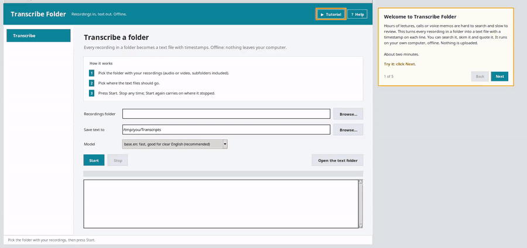
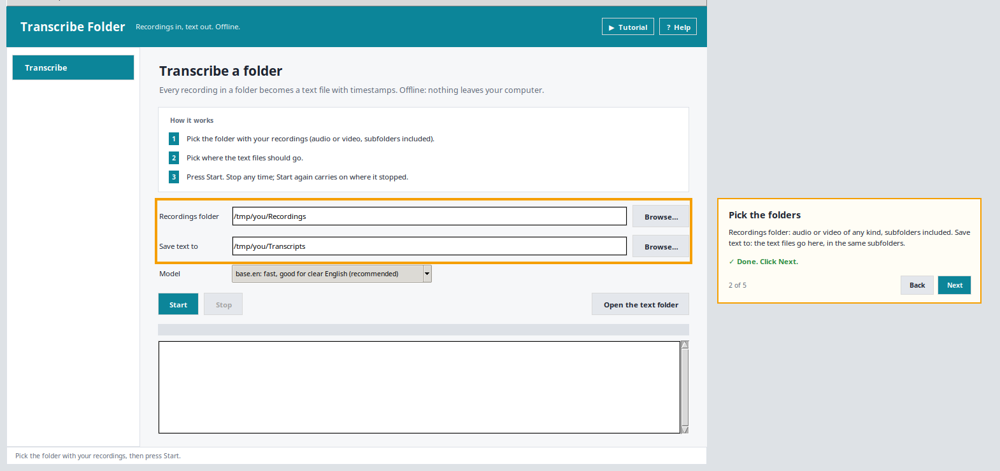
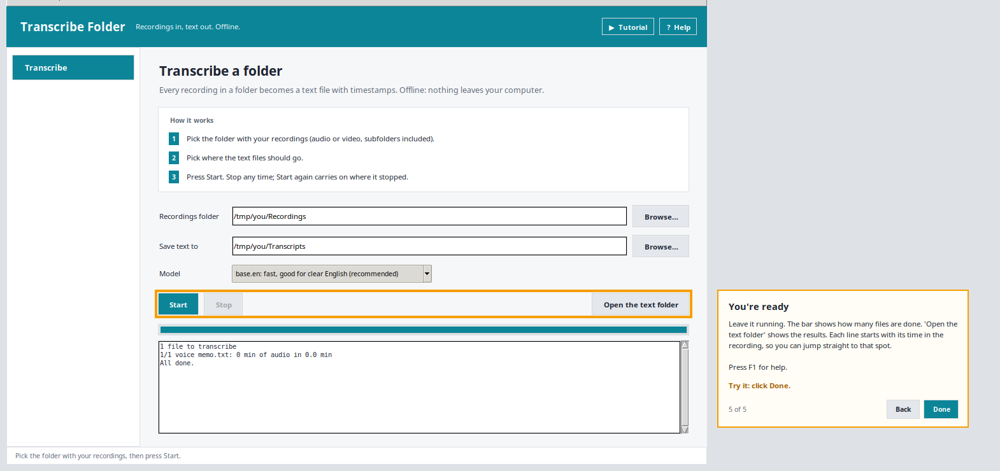

# Transcribe Folder

**Point it at a folder of recordings. Get a text file with timestamps for every one. Offline.**

For lectures, courses, podcasts, interviews and voice memos. Every audio and video file in the folder (and its subfolders) becomes a text file:

```
[0:00:00] Welcome back. Last week we covered the basics of compound interest.
[0:00:04] Today we'll look at what happens when you add a little every month,
[0:00:09] and why starting early matters more than the amount.
```

Free, no account. Nothing leaves your computer. Windows, Mac and Linux.



*The first time you open it, a two-minute tutorial walks you through picking a folder, choosing a model and starting. ([Full video](docs/tutorial.mp4))*

---

## Why this exists

We had a course: about 140 recordings, many over an hour long, some over three. Hours of good material that we couldn't search, skim or quote, and listening again to find one sentence takes as long as the first time.

Speech-to-text models are now good enough to run on an ordinary laptop. But the first attempt with the usual tools went wrong in three ways:
- **It ran out of memory.** A three-hour video was loaded whole, and the laptop killed the job a hundred files in.
- **Every crash started from scratch.** Hours of finished work were lost.
- **It took over the computer.** Nothing else could run while it worked.

So we rebuilt it around the laptop instead of around the model:
- **Small pieces.** Each recording is cut into 20-minute pieces, so even a 3-hour video never has to fit in memory.
- **Save as you go.** Each piece's text is saved as soon as it's done. A crash, a reboot or a flat battery costs at most one piece, and the next run carries on.
- **Leave room for you.** It uses 2 CPU threads by default, and an optional guard pauses it when other programs need the memory.

Over 130 recordings finished that way on a two-core laptop, in the background, while the laptop was in use.

## What it can replace

Transcribe Folder is built to be a free, private alternative to these.

| If you use… | It's good at… | What Transcribe Folder does instead |
|---|---|---|
| **Otter.ai** | Live meeting notes, speaker names | Your audio goes to their servers, and the free plan caps minutes. Here it's offline and unlimited. |
| **Rev, TranscribeMe** | Human-checked accuracy | They charge by the minute, and a whole course costs real money. Here it's free. Pay a human only for the one recording that must be perfect. |
| **Descript** | Editing audio by editing text | Built for one recording at a time, with a subscription. Here you give it a whole folder and walk away. |
| **MacWhisper** and similar apps | A nice Whisper app | Mac only, and often one file at a time. Here it works on every system, does whole folders, and resumes after a crash. |
| **YouTube's automatic captions** | Free captions | Only for videos you upload, and only on YouTube. Here it works for any file on your computer, without uploading anything. |

## How to use what you get

- **Search.** Every course, talk and memo becomes searchable with your normal file search or `grep`. Find the moment someone said "compound interest", then jump to `[0:00:04]` in the video.
- **Study.** Pull your questions and flashcards from the text. [Learning Kit](https://github.com/sebaytlabs/learning-kit) takes cards as plain `question :: answer` lines.
- **Write.** Quote a talk accurately, write show notes for a video, or turn a voice memo into a draft.

## Download

Free, no account. Get the file for your computer from the [latest release](https://github.com/sebaytlabs/transcribe-folder/releases/latest):

| Your computer | File | Then |
|---|---|---|
| Windows 10 or 11 | `TranscribeFolder-<version>-windows-setup.exe` | Run it. If Windows says *Windows protected your PC*, click **More info → Run anyway** (once). |
| Mac with Apple chip (M1 and later) | `TranscribeFolder-<version>-mac-ARM64.dmg` | Open it and drag Transcribe Folder to Applications. The first time, macOS says it can't check the app: open **System Settings → Privacy & Security**, scroll down and click **Open Anyway** (once). |
| Mac with Intel chip | `TranscribeFolder-<version>-mac-X64.dmg` | Same as above. |
| Linux | `TranscribeFolder-<version>-x86_64.AppImage` | Make it runnable (right-click → Properties → *Allow executing*, or `chmod +x` it), then double-click it. |

The download includes the speech engine. It still needs **ffmpeg** to read your recordings: `winget install ffmpeg` (Windows), `brew install ffmpeg` (Mac), `sudo apt install ffmpeg` (Linux). The first run of each model downloads it once (about 150 MB for base.en).

The apps aren't signed with a paid developer certificate yet, which is why Windows and macOS ask once.

## Start

To run it from source instead, you need Python 3.9 or newer and ffmpeg (`apt install ffmpeg` / `brew install ffmpeg` / `winget install ffmpeg`).

```
git clone https://github.com/sebaytlabs/transcribe-folder
cd transcribe-folder
python3 transcribe_app.py
```

The first time, a **tutorial** shows you each part:
1. Pick a folder of recordings.
2. Choose a model.
3. Press Start.

The **▶ Tutorial** button runs it again, and **F1** shows help.

Pick the folder with your recordings and where the text should go, choose a model, and press **Start**. A progress bar and a log show where it is. **Stop** works any time, and **Start** carries on from there. If the speech model package isn't installed, the app sets it up the first time in its own folder (`~/.local/share/transcribe-folder`), so nothing on your system changes.

**What you get:**
- **True timestamps.** `[1:02:15]` means 1 hour 2 minutes 15 seconds into the whole file, not into the piece.
- **The same layout.** The output mirrors your folders, so `course/week 3/lecture.mp4` becomes `out/week 3/lecture.txt`.

Built on [faster-whisper](https://github.com/SYSTRAN/faster-whisper), an efficient version of OpenAI's Whisper speech model.

## From the command line

```
pip install faster-whisper            # plus ffmpeg: apt install ffmpeg / brew install ffmpeg / winget install ffmpeg
python3 transcribe.py ~/Courses/Spanish ~/Transcripts/Spanish
python3 transcribe.py ~/Podcasts ~/Transcripts --model small.en --only "2026"
python3 transcribe.py talk.mp4 ~/Transcripts --language auto --model large-v3
```

| Option | Default | |
|---|---|---|
| `--model` | `base.en` | `tiny.en` is fastest; `small.en` and `medium.en` are more accurate. `large-v3` handles any language. |
| `--language` | `en` | a language code, or `auto` to detect it |
| `--threads` | `2` | more threads run faster but leave less for everything else |
| `--only TEXT` | | only the files whose path contains TEXT |

Measured on a two-core laptop: `base.en` turned 3 minutes of lecture audio into text in 9 seconds, using about 450 MB of memory at its peak (`tiny.en`: 5 seconds). Bigger models are much slower. The model downloads once, on first use.

## Big jobs: pause when memory runs low (Linux)

Run the transcriber as a user service with a memory cap. Then let `memguard.sh` stop it when other programs need the memory, and start it again when the memory is free:

```
systemd-run --user --unit transcribe -p MemoryMax=2G \
  python3 ~/transcribe-folder/transcribe.py ~/Courses ~/Transcripts
~/transcribe-folder/memguard.sh transcribe 300 1700 &
```

The job pauses if free memory stays under 300 MB for a minute, and resumes once more than 1.7 GB is free. Because the transcriber is resumable, a pause costs at most one 20-minute piece.

## Tests

```
python3 -m unittest discover tests     # needs ffmpeg; uses a stand-in for the model
```

## Screenshots


*Pick a folder of recordings and where the text goes.*


*Start, watch the progress, stop any time.*

## Related tools

- **[Learning Kit](https://github.com/sebaytlabs/learning-kit).** Turn what you transcribed into questions, flashcards and quizzes.
- **[SimpleBrain](https://github.com/sebaytlabs/simplebrain).** Keep transcripts beside your notes, and link and search them with everything else.
- **[Clip Pipeline](https://github.com/sebaytlabs/clip-pipeline).** Transcribe your own videos for show notes and captions.

## Limits, plainly

- **Whisper sometimes invents text,** especially over long silences, music or noise, and it does so confidently (a documented weakness of the model). Before you quote a line, jump to its timestamp and listen.
- **No speaker names.** You get what was said, not who said it.
- **Accuracy drops** with heavy accents, crosstalk, poor microphones and technical words. A bigger model helps, at the cost of speed.
- **The `.en` models are English only.** Use `large-v3` (slow) for other languages.
- **Only transcribe what you're allowed to.** A transcript of a paid course is for your own study, not for sharing.

## License

MIT. Made by [Sebayt Labs](https://sebaytlabs.com). We build free tools when the usual ones are too expensive, too complicated, or don't do the job.
